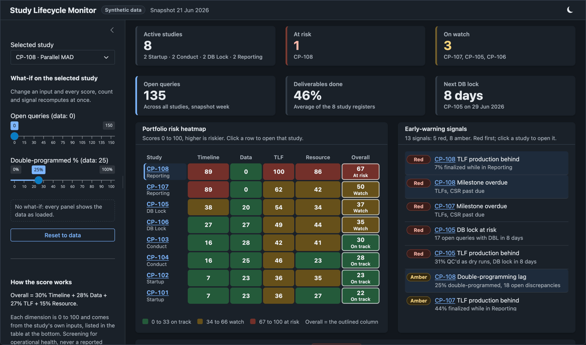

```{r setup}
library(ggplot2); library(knitr)
source("../shiny/R/logic.R")
source("../../assets/theme/theme.R")   # bp_tokens and bp_ggplot_theme: figure ink per site theme
d  <- lifecycle_load("../shiny/data")
st <- score_portfolio(d)
k  <- lifecycle_kpis(st, d)
```

```{=html}
<style>
svg[id^="mermaid"]{ width:100% !important; max-width:940px; height:auto; display:block; margin:8px auto; }
svg[id^="mermaid"] .nodeLabel, svg[id^="mermaid"] .edgeLabel { font-size:16px !important; }
</style>
```

::: {.callout-note appearance="simple"}
**Run / share / read / build - pick your mode.** This page *shows* the console (diagrams + a live roll-up computed from the portfolio), the [**run-and-build page**](lifecycle-build.html) lets you *run* it and nudge a what-if, the [dashboard](lifecycle-dashboard.html) is a shareable snapshot, and the [run-and-build page](lifecycle-build.html) shows how it is made. Synthetic, no PHI, no participant-level data. A screening lens for operational health, never a reported clinical number.
:::

::: {.callout-tip appearance="simple"}
**A Shinylive build of the console, smoke-tested before each deploy.** [Open it in your browser](../../apps/lifecycle_dashboard/). It is the same R Shiny app, exported to run on R compiled to WebAssembly (Shinylive and webR) with no server: everything it needs loads from this site, and what you click stays in your browser. Synthetic data only. Before each deploy, the site's publishing workflow opens it in headless Chrome as a first-time visitor and deploys nothing unless it starts, fills its panels with the expected values and shows no error ([run history](https://github.com/patrickiben/biometrics-ai-portfolio/actions/workflows/pages.yml)); the same check passed on a local build on 25 October 2026. Safari and Firefox are not checked.

**Before you open it:** R starts inside your browser, so the console takes several seconds to appear. The first visit downloads about 65 MB, shared with the other two apps on this site; later visits reuse the browser cache. It works best in Chrome or Edge; Safari support may vary. If it does not load, the screenshot below and the [read-only snapshot](lifecycle-dashboard.html) show the same screens.

{fig-alt="The Study Lifecycle Monitor in the dark theme, scrolled past its Start here card: KPI boxes reading 8 active studies, 1 at risk (CP-108), 3 on watch, 135 open queries, 46% of deliverables done and the next DB lock in 8 days (CP-105); the portfolio risk heatmap with CP-108 selected; and the ranked early-warning signals, red first."}
:::

## What it watches

Operational health of every study from protocol to CSR, on one screen: are milestones slipping, is the query backlog clearing before database lock, is TLF production keeping pace, is double-programming on track.

```{mermaid}
flowchart LR
  accTitle: Study lifecycle phases
  accDescr: Startup, conduct, database lock and reporting in sequence, with their milestones: protocol, SAP and first participant first visit; last participant last visit; database lock; TLFs and the CSR.
  S[Startup] --> C[Conduct] --> L[DB Lock] --> R[Reporting]
  S -.-> M1["Protocol<br/>SAP · FPFV"]
  C -.-> M2[LPLV]
  L -.-> M3[DBL]
  R -.-> M4["TLFs · CSR"]
```

## How the risk score works - it is transparent

No black box. Each study gets four operational sub-scores (0-100), blended into one:

```{mermaid}
flowchart LR
  accTitle: Operational risk score
  accDescr: Timeline, data, TLF and resource scores combine into an overall score, 0.30 T plus 0.28 D plus 0.27 F plus 0.15 R, which maps to red, amber or green bands.
  T["Timeline<br/>overdue + lock pressure"] --> O
  D["Data<br/>queries + clean/SDV"] --> O
  F["TLF<br/>finalized vs pressure"] --> O
  Rs["Resource<br/>double-prog + discrep"] --> O
  O{{"overall = 0.30·T + 0.28·D<br/>+ 0.27·F + 0.15·R"}}
  O --> RAG["RAG bands<br/>red · amber · green"]
```

Because it is a formula, you can defend every number and change what "risk" means in one place (`score_study()` in `R/logic.R`).

## The live portfolio - computed from the data {#live}

Everything below is rendered from four CSVs, the same files the Shiny app reads: [`studies.csv`](../shiny/data/studies.csv), [`milestones.csv`](../shiny/data/milestones.csv), [`deliverables.csv`](../shiny/data/deliverables.csv), and [`query_trend.csv`](../shiny/data/query_trend.csv) (in the [`shiny/data/`](../shiny/data/) folder). Edit those CSVs (or run the app) and these move.

```{r kpis, results='asis'}
box <- function(label, value, col) sprintf(
  '<div style="flex:1 1 120px;background:var(--surface);border:1px solid var(--line-2);border-radius:10px;padding:14px 16px"><div style="font-size:28px;font-weight:700;color:%s;font-family:monospace;line-height:1">%s</div><div style="font-size:12px;color:var(--muted);text-transform:uppercase;letter-spacing:.05em;margin-top:6px">%s</div></div>',
  col, value, label)
cat('<div style="display:flex;flex-wrap:wrap;gap:10px;margin:6px 0 18px">')
cat(box("Active studies", k$n, "var(--ink)"))
cat(box("At risk", k$at_risk, "var(--red)"))
cat(box("On watch", k$watch, "var(--amber)"))
cat(box("Open queries", k$open_q, "var(--ink)"))
cat(box("Avg deliverables", paste0(k$avg_del,"%"), "var(--accent)"))
cat(box("Next DB lock", ifelse(is.na(k$next_dbl_days),"-",paste0(k$next_dbl_days,"d")), "var(--blue)"))
cat('</div>')
```

::: {.panel-tabset}

### Risk heatmap

```{r heat, fig.width=8, fig.height=4, fig.alt="Risk heatmap: each study's timeline, data, TLF and resource sub-scores from 0 to 100, colored green to amber to red."}
dims <- c("Timeline","Data","TLF","Resource")
hl <- do.call(rbind, lapply(dims, function(dm) data.frame(id=st$id, dim=dm, value=st[[dm]])))
hl$id <- factor(hl$id, levels=rev(st$id)); hl$dim <- factor(hl$dim, levels=dims)
for (mode in "dark") print(
  ggplot(hl, aes(dim, id, fill=value)) +
    geom_tile(colour=bp_tokens[[mode]][["surface"]], linewidth=1.5) +
    geom_text(aes(label=value), colour="#0b1020", fontface="bold", size=4) +
    scale_fill_gradientn(colours=c("#43c47d","#e0a64c","#e8657a"), limits=c(0,100)) +
    labs(x=NULL, y=NULL) +
    bp_ggplot_theme(mode) + theme(legend.position="none", panel.grid=element_blank()))
```

### Ranked signals

```{r sig}
sg <- lifecycle_signals(st, d)
kable(head(sg[, c("sev","who","title","msg")], 10),
      col.names=c("Severity","Study","Signal","Detail"), row.names=FALSE)
```

:::

## Run it - and change it {#run}

```r
shiny::runApp("lifecycle_dashboard/shiny")
# needs: install.packages(c("shiny","bslib","ggplot2"))
```

Pick a study, then move the what-if sliders (open queries, double-programming) and
watch that study's row in the heatmap re-color. The [run-and-build page](lifecycle-build.html)
shows how the app is built from `R/logic.R`.

::: {.callout-tip appearance="simple"}
**Going live:** `R/gen_data.R` writes the four CSVs ([`studies.csv`](../shiny/data/studies.csv), [`milestones.csv`](../shiny/data/milestones.csv), [`deliverables.csv`](../shiny/data/deliverables.csv), [`query_trend.csv`](../shiny/data/query_trend.csv)) so you can see the shape. Replace them with a read-only CTMS / EDC export carrying the same columns and the console is your portfolio. Nothing writes back to a source system.
:::

## The other formats

| Mode | Artifact |
|---|---|
| Run | [Run &amp; build the Shiny app](lifecycle-build.html) |
| Share (no R) | [Dashboard](lifecycle-dashboard.html) |
| Build | [Run-and-build walkthrough](lifecycle-build.html) |

*Synthetic, deterministic, no PHI. Operational screening, not a clinical readout.*
