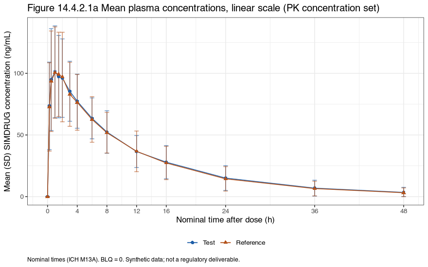
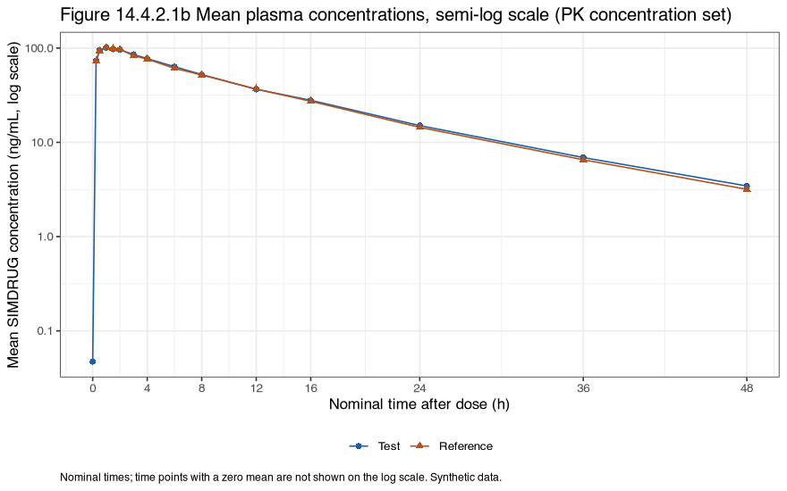
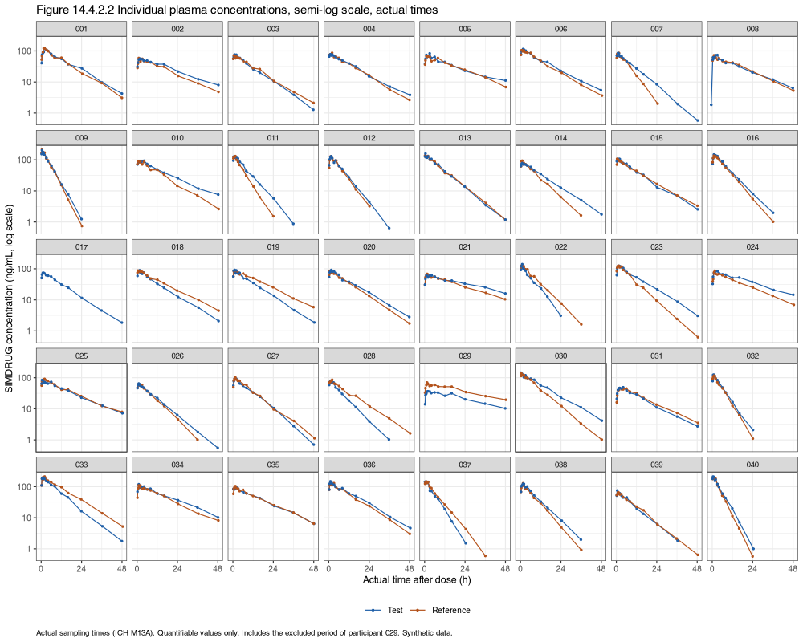

```{r setup}
suppressPackageStartupMessages({ library(rtables); library(dplyr) })
O <- readRDS(params$objects)
f1 <- function(x, d) formatC(x, format = "f", digits = d)
be <- O$be_results
cm <- be[be$PARAMCD == "CMAX", ]; au <- be[be$PARAMCD == "AUCLST", ]; ai <- be[be$PARAMCD == "AUCIFO", ]
tbl <- function(id) htmltools::HTML(paste0('<div class="tlf tblwrap">',
  sub("<table ", '<table data-quarto-disable-processing="true" ', as.character(as_html(O$TLF[[id]]$tt)), fixed = TRUE), "</div>"))
n_set <- function(fl) sum(O$adsl[[fl]] == "Y")
`%||%` <- function(a, b) if (is.null(a)) b else a
```

::: {.synthetic}
Synthetic data only: simulated for this worked example; not real trial data and not a regulatory deliverable. Every number below is computed by `study/run_all.R` from code in this repository.
:::

## Summary

Bioequivalence of the test tablet (T) to the reference tablet (R) was **`r if (O$be_pass) "shown" else "not shown"`** for both primary parameters in `r cm$n` participants (bioequivalence set). The ratio of geometric means T/R was `r f1(100 * cm$ratio, 2)`% for Cmax (90% CI `r f1(100 * cm$lower, 2)`% to `r f1(100 * cm$upper, 2)`%) and `r f1(100 * au$ratio, 2)`% for AUC(0-t) (90% CI `r f1(100 * au$lower, 2)`% to `r f1(100 * au$upper, 2)`%), both within 80.00% to 125.00% (ICH M13A). The supportive AUC(0-inf) ratio was `r f1(100 * ai$ratio, 2)`% (`r f1(100 * ai$lower, 2)`% to `r f1(100 * ai$upper, 2)`%) in the `r ai$n` participants whose AUC(0-inf) met the SAP parameter rules in both periods.

The within-participant CV was `r f1(cm$cv_within, 1)`% for Cmax and `r f1(au$cv_within, 1)`% for AUC(0-t), below the `r O$design$cv_pct`% assumed in the sample size, so both intervals are narrower than planned. In this simulation Cmax varies little within a participant because the simulator's occasion-to-occasion variability acts on clearance.

## Analysis sets and exclusions

```{r sets}
sets <- data.frame(`Analysis set` = c("Enrolled (randomized)", "Safety", "PK concentration", "PK parameter", "Bioequivalence"),
                   Participants = c(n_set("RANDFL"), n_set("SAFFL"), n_set("PKCFL"), n_set("PKPFL"), n_set("BEFL")), check.names = FALSE)
knitr::kable(sets, format = "html", table.attr = 'class="data"')
```

```{r excl}
ex <- O$exclusions %>% filter(!is.na(PKEXRSN) | (!is.na(PREDOSE) & PREDOSE > 0)) %>%
  transmute(Participant = sub("^SIMBE01-101-", "", USUBJID), Period = APERIOD, Treatment = TRTA,
            `Pre-dose (% of Cmax)` = ifelse(is.na(PREDOSE_PCT), "", f1(PREDOSE_PCT, 1)),
            Decision = ifelse(is.na(PKEXRSN), "kept (below the 5% rule)", tolower(PKEXRSN)))
knitr::kable(ex, format = "html", table.attr = 'class="data"', caption = "Periods with an exclusion rule triggered or a measurable pre-dose concentration")
```

The simulated scenarios and what the SAP rules did with each (read from ADSL and the evaluated exclusion rules):

```{r scenarios}
scn <- do.call(rbind, lapply(O$scenarios, function(x) {
  u <- x$usubjid; p <- x$period %||% NA
  rs <- O$exclusions$PKEXRSN[O$exclusions$USUBJID == u & !is.na(O$exclusions$PKEXRSN)]
  data.frame(Participant = sub("^SIMBE01-101-", "", u), Scenario = x$what,
             `Period excluded` = if (length(rs)) tolower(paste(unique(rs), collapse = "; ")) else "no",
             `Bioequivalence set` = ifelse(O$adsl$BEFL[O$adsl$USUBJID == u] == "Y", "yes", "no"), check.names = FALSE)
}))
knitr::kable(scn, format = "html", table.attr = 'class="data"', row.names = FALSE, caption = "Documented scenarios (03_adam/sdtm/scenarios.json)")
```

A withdrawn participant keeps the profiles they have in the PK summaries but has no data for the other product, so leaves the bioequivalence set. A missed sample is omitted and nothing is imputed.

## NCA

PKNCA `r O$versions[["PKNCA"]]` on actual sampling times (pre-dose samples at time 0), AUC by linear-up/log-down (linear when a concentration is 0), values below the LLOQ set to 0 wherever they fall and left out of the lambda z fit (`conc.blq = list(first = "keep", middle = "keep", last = "keep")`), lambda z from at least 3 points after tmax chosen by adjusted R-squared. The SAP parameter rules are applied with PKNCA `exclude()`: AUC(0-inf) is not summarized or analyzed when more than `r O$sap$nca$max_aucinf_pext_pct`% is extrapolated, and lambda z-based parameters when the adjusted R-squared is below `r f1(O$sap$nca$min_hl_adj_r_squared, 2)`; the values stay in ADPP with NCAEXRSN set.

```{r blqeffect}
be_txt <- O$blq_effect %>% transmute(Participant = sub("^SIMBE01-101-", "", USUBJID), Period = APERIOD, Treatment = TRTA, Parameter = PARAMCD,
                                     `BLQ kept as 0 (ICH M13A, used)` = f1(M13A, 2), `PKNCA default (BLQ dropped)` = f1(PKNCA_default, 2),
                                     `Difference (%)` = f1(pct_difference, 1))
knitr::kable(be_txt, format = "html", table.attr = 'class="data"', row.names = FALSE,
             caption = "What the ICH M13A BLQ setting changes: the same NCA with the PKNCA default (a BLQ value between quantifiable samples dropped). Only values that differ are listed.")
```

```{r m13checks}
pk <- O$pk_checks %>% transmute(Check = check, Result = sprintf("%d of %d (%s%%)", value, denominator, f1(pct, 1)), Rule = rule, Met = ifelse(ok, "yes", "no"))
knitr::kable(pk, format = "html", table.attr = 'class="data"', caption = "ICH M13A acceptability checks (executed)")
```

## Concentrations

{width=100% fig-alt="Mean (SD) plasma concentrations of the test and reference products against nominal time after dose, 0 to 48 hours, on a linear scale. Synthetic data."}

{width=100% fig-alt="The same mean concentration profiles of the test and reference products on a semi-log scale against nominal time. Synthetic data."}

{width=100% fig-alt="Each participant's concentration profile for the test and reference products on a semi-log scale against actual sampling time. Synthetic data."}

```{r conc}
tbl("t_14_4_1_1")
```

## PK parameters

```{r par}
tbl("t_14_4_4_1")
```

## Bioequivalence

```{r be}
tbl("t_14_4_3_1")
tbl("t_14_4_3_2")
```

```{r firstpoint}
fp <- O$first_point %>% transmute(Participant = sub("^SIMBE01-101-", "", USUBJID), Period = APERIOD, Treatment = TRTA,
                                  `First post-dose sample, nominal (h)` = formatC(FIRST_NRRLT, format = "fg"),
                                  `tmax, actual (h)` = f1(TMAX, 3), `Bioequivalence set` = ifelse(BEFL == "Y", "yes", "no"))
knitr::kable(fp, format = "html", table.attr = 'class="data"', row.names = FALSE,
             caption = "Profiles with Cmax at the first post-dose sample (ICH M13A 2.1.8.1): the true Cmax may have come earlier")
```

```{r supp}
sp <- O$be_supplementary %>% transmute(Analysis = sub("^[0-9] ", "", analysis), Parameter = c(CMAX = "Cmax", AUCLST = "AUC(0-t)", AUCIFO = "AUC(0-inf)")[PARAMCD], n,
                                    `Ratio T/R (%)` = f1(100 * ratio, 2),
                                    `90% CI (%)` = paste0(f1(100 * lower, 2), ", ", f1(100 * upper, 2)),
                                    `Within limits` = ifelse(within_limits, "Yes", "No"))
knitr::kable(sp, format = "html", table.attr = 'class="data"', row.names = FALSE,
             caption = "Supplementary analyses: (1) excluded periods put back for participants with both periods; (2) the bioequivalence set without the participants with Cmax at the first post-dose sample")
```

## Safety

```{r safety}
tbl("t_14_1_2")
tbl("t_14_3_1_1")
```

## What this report is and is not

- It is executed output from one script (`study/run_all.R`) on synthetic data, with package versions pinned in `study/renv.lock`.
- The results were re-derived by a second method by the same author (NonCompart for NCA, two other fitting routes for the model); see the [QC ledger](../../05_qc/qc_ledger.html). That is not independent double programming by a second person.
- Not a validated system, not a submission package: no define.xml, no ADRG, no Pinnacle 21 or CDISC CORE run.

[Back to the worked example](../../index.html)
