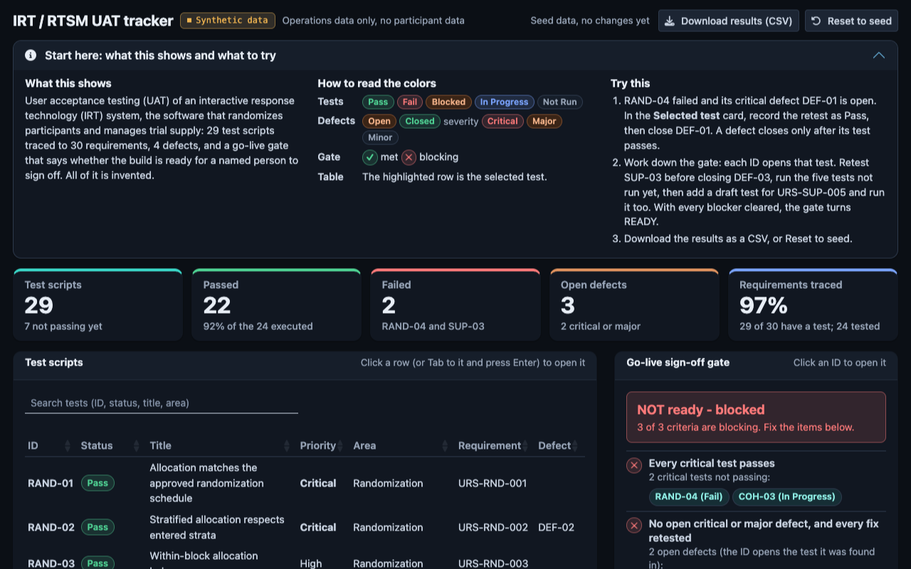

```{r setup}
library(ggplot2); library(knitr)
source("../shiny/R/logic.R")
source("../../assets/theme/theme.R")   # bp_tokens and bp_ggplot_theme: figure ink per site theme
d <- uat_load("../templates")
g <- uat_gate(d$tests, d$defects, d$trace)
s <- uat_summary(d$tests, d$defects, d$trace)
```

```{=html}
<style>
svg[id^="mermaid"]{ width:100% !important; max-width:940px; height:auto; display:block; margin:8px auto; }
svg[id^="mermaid"] .nodeLabel, svg[id^="mermaid"] .edgeLabel { font-size:16px !important; }
</style>
```

::: {.callout-note appearance="simple"}
**Watch / explore / read / build, pick your mode.** This page *shows* the UAT (diagrams + a live dashboard computed from the data), the [**runnable R Shiny app**](uat-build.html) lets you *run* one, the [build-it walkthrough](uat-build.html) shows how the app is made, and the [Excel workbook](../UAT_IRT_RTSM_Workbook.xlsx) is what you file. Operations-only, synthetic, no PHI. We say *participant*, not *subject*.
:::

::: {.callout-tip appearance="simple"}
**A Shinylive build of the tracker, smoke-tested before each deploy.** [Open it in your browser](../../apps/uat_irt/). It is the same R Shiny app, exported to run on R compiled to WebAssembly (Shinylive and webR) with no server: everything it needs loads from this site, and what you click stays in your browser. Synthetic data only. Before each deploy, the site's publishing workflow opens it in headless Chrome as a first-time visitor and deploys nothing unless it starts, fills its panels with the expected values and shows no error ([run history](https://github.com/patrickiben/biometrics-ai-portfolio/actions/workflows/pages.yml)); the same check passed on a local build on 25 October 2026. Safari and Firefox are not checked.

**Before you open it:** R starts inside your browser, so the tracker takes several seconds to appear. The first visit downloads about 65 MB, shared with the other two apps on this site; later visits reuse the browser cache. It works best in Chrome or Edge; Safari support may vary. If it does not load, the screenshot below and the [read-only snapshot](uat-dashboard.html) show the same screens.

{fig-alt="The UAT tracker as it opens, in the dark theme: the Start here guide with the color key and three things to try, five KPI boxes (29 test scripts, 22 passed, 2 failed, 3 open defects, 97% of requirements traced), the start of the test-script table and the go-live gate reading NOT ready - blocked."}
:::

## What a UAT is, in one picture

You are confirming, in a test environment, that the vendor's randomization and drug-supply build does **exactly** what your specs say, before a single real participant is randomized.

```{mermaid}
flowchart LR
  accTitle: UAT process
  accDescr: Requirements and specifications become test cases, which are executed in the staging IRT and recorded with screenshots; a failure is logged as a defect and retested, a pass feeds traceability, and the go-live gate promotes the build to production only when it reads ready and a human signs.
  URS["URS + specs"] --> TC["Derive<br/>test cases"] --> EX["Execute in<br/>staging IRT"]
  EX --> REC["Record +<br/>screenshot"] --> DEC{"Pass?"}
  DEC -->|No| DEF["Log defect,<br/>retest build"] --> EX
  DEC -->|Yes| TR["Traceability"] --> GATE{{"Go-live<br/>gate"}}
  GATE -->|"READY,<br/>human signs"| PROD["Promote to<br/>production"]
  GATE -->|blocked| EX
```

## Where it actually runs, the systems

The tracker you see below is a **picture**. The real UAT happens across three live places, and the workbook is the paper trail that ties them together.

```{mermaid}
flowchart LR
  accTitle: Where UAT runs
  accDescr: The biostatistician operates the vendor staging IRT in a browser, keeps dated screenshots and exports in the Excel workbook that is the record, and files the signed package in the eTMF; defects go to the vendor tracker and come back as a fixed build.
  subgraph vendor["Vendor systems"]
    IRT["Staging IRT / RTSM<br/>(test list)"]
    VDEF["Vendor defect<br/>tracker"]
  end
  subgraph you["You, the biostatistician"]
    BR["Operate in<br/>a browser"]
    EV["Dated screenshots<br/>+ exports"]
    WB[("Excel workbook<br/>the record")]
  end
  ETMF[["eTMF:<br/>signed package"]]
  IRT --> BR --> EV --> WB --> ETMF
  BR --> VDEF -->|"fixed build"| IRT
```

::: {.callout-important appearance="simple"}
The workbook does not connect to the IRT. You **transcribe** results into it, on purpose, so the record is attributable and stands on its own for an auditor. Every number comes from the validated systems (the IRT, the test list, your reconciliation), never from an assistant.
:::

## The live tracker, computed from the data {#live}

This is the same logic the Shiny app and the Excel gate use, rendered here from the three data files: [`test_scripts.csv`](../templates/test_scripts.csv), [`defect_log.csv`](../templates/defect_log.csv), and [`traceability_matrix.csv`](../templates/traceability_matrix.csv) (in the [`templates/`](../templates/) folder). Edit those CSVs (or run the app) and these move.

```{r kpis, results='asis'}
box <- function(label, value, col) sprintf(
  '<div style="flex:1 1 120px;background:var(--surface);border:1px solid var(--line-2);border-radius:10px;padding:14px 16px"><div style="font-size:30px;font-weight:700;color:%s;font-family:monospace;line-height:1">%s</div><div style="font-size:12px;color:var(--muted);text-transform:uppercase;letter-spacing:.05em;margin-top:6px">%s</div></div>',
  col, value, label)
cat('<div style="display:flex;flex-wrap:wrap;gap:10px;margin:6px 0 18px">')
cat(box("Test scripts", s$total, "var(--ink)"))
cat(box("Passed", s$pass, "var(--green)"))
cat(box("Failed", s$fail, "var(--red)"))
cat(box("Open defects", s$open_def, "var(--amber)"))
cat(box("Requirements traced", paste0(s$cov, "%"), "var(--accent)"))
cat('</div>')
```

::: {.panel-tabset}

### Go-live gate

```{r gate, results='asis'}
tick <- function(ok, txt) sprintf('<div style="margin:6px 0;font-size:15px;color:var(--ink)"><span style="color:%s;font-weight:700;margin-right:6px">%s</span>%s</div>',
  if (ok) "var(--green)" else "var(--red)", if (ok) "&#10004;" else "&#10008;", txt)
bg <- if (g$go) "var(--green-soft)" else "var(--red-soft)"; bd <- if (g$go) "var(--green)" else "var(--red)"
cat(sprintf('<div style="background:%s;border:1px solid %s;border-radius:12px;padding:16px 18px;max-width:660px">', bg, bd))
cat(sprintf('<div style="font-size:22px;font-weight:700;margin-bottom:8px;color:var(--ink)">%s</div>', g$verdict))
cat(tick(g$crit_fail == 0, sprintf("<b>%d</b> critical test(s) not yet passing", g$crit_fail)))
cat(tick(g$open_cm == 0,  sprintf("<b>%d</b> open critical/major defect(s)", g$open_cm)))
cat(tick(g$trace_gap == 0, sprintf("<b>%d</b> requirement(s) without a test", g$trace_gap)))
cat('<div style="font-size:12px;color:var(--muted);margin-top:10px">The gate packages the evidence; a named human signs. It does not grant approval.</div></div>')
```

The gate is deliberately **conjunctive**: all three conditions must hold. In the seed data it reads *blocked* because a critical test is still failing, two critical/major defects are open, and one requirement has no test yet. Fix those in the app and watch it flip.

### Execution by area

```{r plot, fig.alt="Test scripts by test area, stacked by status: pass, fail, blocked, in progress and not run."}
#| renderings: [light, dark]
df <- uat_area_counts(d$tests)
for (mode in c("light", "dark")) print(
  ggplot(df, aes(Freq, Area, fill = Status)) +
    geom_col(width = 0.7) +
    scale_fill_manual(values = c("Pass"="#43c47d","Fail"="#e8657a","Blocked"="#e0a64c",
      "In Progress"="#5b8cff","Not Run"="#6b7794"), drop = FALSE) +
    labs(x = "Tests", y = NULL, fill = NULL) +
    bp_ggplot_theme(mode) + theme(legend.position = "top"))
```

### Open defects

```{r defects}
od <- d$defects[d$defects$Status == "Open", c("DefectID","Severity","FoundInTest","Description")]
kable(od, col.names = c("Defect","Severity","In test","Description"), row.names = FALSE)
```

:::

## Run it, and change it {#run}

The interactive tool is a real R Shiny app you own. From the package root:

```r
install.packages(c("shiny", "bslib", "DT", "ggplot2"))   # once
shiny::runApp("uat_irt/shiny")
```

Select a test, mark it Pass/Fail, close a defect, and the KPIs and the go-live gate recompute live. Download your results to CSV to drop into the Excel workbook and the eTMF.

::: {.callout-tip appearance="simple"}
**You want to build these yourself.** `shiny/R/logic.R` holds the gate and KPI math (the functions this page also called), and `shiny/app.R` is the UI and reactivity. The [build-it walkthrough](uat-build.html) takes you through the complete source, line by line. Change the CSV to your study's tests and it is your tracker.
:::

## How to write a test that is actually executable

A good test has a specific, verifiable expected result, not "works correctly". Two worked examples:

::: {.panel-tabset}

### Stratified allocation (RAND-02)

- **Precondition:** test list loaded in staging; the <70 kg stratum, block 1, has an unused slot; you know the next expected list entry.
- **Steps:** log in as Investigator, register participant 101-001 at weight 68.0 kg, Randomize, record the kit and confirmation, open the allocation report as the unblinded statistician.
- **Expected:** 101-001 is allocated to the **next unused <70 kg / block-1 entry**; arm, sequence, and kit match the list; the investigator sees a **kit ID only**, not the arm.
- **Verify:** put the test list next to the IRT output and confirm cell-for-cell across *every* stratum and both arms of the ratio, not one happy-path participant.

### Emergency unblinding (UNBL-01)

- **Precondition:** a randomized test participant exists; you hold the unblinding-authorized role.
- **Steps:** open the participant, invoke emergency unblind, enter a reason, confirm, check the audit trail, then log in as a **blinded** role and confirm the arm is still hidden.
- **Expected:** arm revealed to the authorized role only; unblinding written to the audit trail (who / when / why); participant flagged; blinded role still cannot see the arm; any required safety notification fires.

:::

## Defect severity drives the gate

```{r sev, results='asis'}
cat('
| Severity | Meaning | Blocks go-live? |
|---|---|---|
| **Critical** | Could compromise safety, break the blind, mis-randomize, mis-dose, or corrupt integrity | **Yes** |
| **Major** | Significant functional error in a key workflow (resupply, wrong kit, missing safety alert) | **Yes, until fixed** |
| **Minor** | Cosmetic / non-functional (a label typo, a missing site number in a subject line) | No; fix or waive with rationale |
')
```

## The other formats

| Mode | Artifact |
|---|---|
| Explore / run | [Run &amp; build the Shiny app](uat-build.html), then run it locally |
| Share (no R) | [Dashboard](uat-dashboard.html), the tracker as a self-contained page |
| Present | [Slides](uat-slides.html) |
| Skim | [One-page cheat-sheet (PDF)](uat-onepager.pdf) |
| File | [Excel workbook](../UAT_IRT_RTSM_Workbook.xlsx), the signed record for the eTMF |
| Build | [Build-it walkthrough](uat-build.html), the complete R source |

*Synthetic data throughout. UAT sign-off is a named-human decision.*
